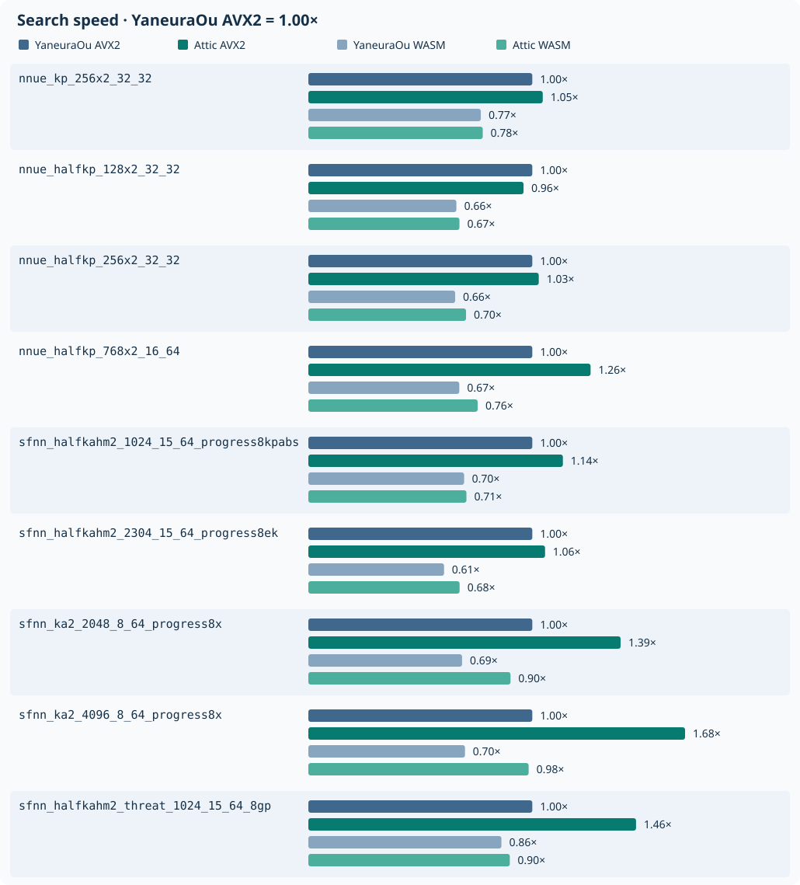

# パフォーマンス

- CPU は Intel Core Ultra 7 265KF の P コア1つ（論理 CPU 7）
- スレッド数 1、置換表 16 MiB、定跡無効
- 同一局面を各ビルドで10回計測
- 評価ファイル読み込み後、`go nodes 1000000` から `bestmove` までを計測

計測局面

```text
sfen +B4g1nl/2g2k3/ppnppsbpp/4r1p2/5p2P/3S2P2/PPPPPP1P1/2GS2S2/LN2KG1NL w Lrp 32
```

## 探索速度比

Linux AVX2 と WASM SIMD128 の測定結果です。各ネットワークで **YaneuraOu AVX2 を 1.00×** とし、その平均探索時間を各ビルドの平均探索時間で割っています。



## NPS

NPS は、探索した実ノード数の合計を経過時間の合計で割って求めました。


| ネットワーク | Attic AVX2 | Attic WASM | YaneuraOu AVX2 | YaneuraOu WASM |
|---|---:|---:|---:|---:|
| `nnue_kp_256x2_32_32` | 989,274 | 736,066 | 945,199 | 727,882 |
| `nnue_halfkp_128x2_32_32` | 1,016,866 | 714,014 | 1,058,241 | 699,505 |
| `nnue_halfkp_256x2_32_32` | 901,692 | 617,054 | 876,395 | 574,534 |
| `nnue_halfkp_768x2_16_64` | 759,590 | 455,661 | 602,754 | 406,297 |
| `sfnn_halfkahm2_1024_15_64_progress8kpabs` | 739,832 | 459,486 | 651,081 | 452,916 |
| `sfnn_halfkahm2_2304_15_64_progress8ek` | 479,533 | 306,441 | 453,730 | 275,065 |
| `sfnn_ka2_2048_8_64_progress8x` | 689,289 | 446,240 | 494,210 | 339,267 |
| `sfnn_ka2_4096_8_64_progress8x` | 508,839 | 297,580 | 302,411 | 211,542 |
| `sfnn_halfkahm2_threat_1024_15_64_8gp` | 360,086 | 221,379 | 246,092 | 212,149 |

平均探索時間と計測条件は [CSV](benchmark/results.csv) を参照してください。

## 計測条件

Attic は Rust release の AVX2 ビルドと単一スレッド WASI ビルドを使いました。YaneuraOu は V9.96 系の AVX2 ビルドと Emscripten ビルドを使いました。WASM は Node.js 26.5.0 で実行しました。

高速化を確認したネットワークでは、累積値の遅延更新や再利用を有効にしたビルドを使っています。Relaxed SIMD は対応ビルドで有効にしました。同時に別のコアで局面照合を実行していました。

## 互換性

[21,884局面の照合結果](compatibility.md#avx2)
