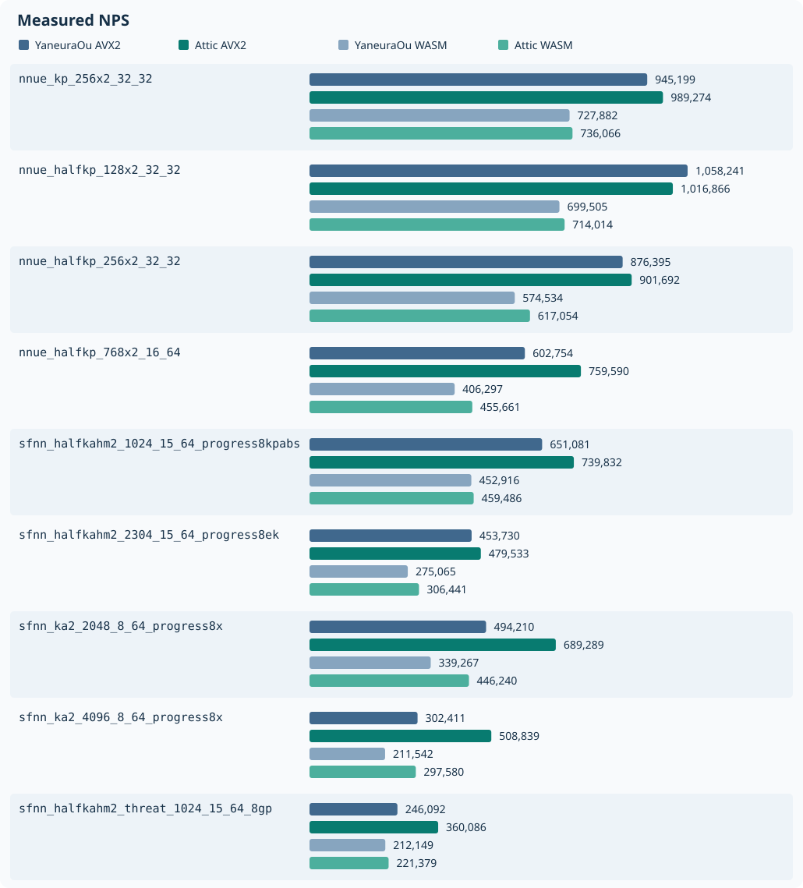

# パフォーマンス

Intel Core Ultra 7 265KF の P コア1つ（論理 CPU 7）に固定し、同じ局面を各ビルド10回ずつ、1スレッド、置換表16 MiB、定跡無効で探索しました。評価ファイルを読み込んだあと、`go nodes 1000000` から `bestmove` までを計測しました。

## 探索速度比

Linux AVX2 と WASM SIMD128 の測定結果です。各ネットワークで **YaneuraOu AVX2 を 1.00×** とし、その平均探索時間を各ビルドの平均探索時間で割っています。


## NPS

NPS は、探索した実ノード数の合計を経過時間の合計で割って求めました。



| ネットワーク | Attic AVX2 | Attic WASM | YaneuraOu AVX2 | YaneuraOu WASM |
|---|---:|---:|---:|---:|
| `nnue_kp_256x2_32_32` | 989,274 | 736,066 | 945,199 | 727,882 |
| `nnue_halfkp_128x2_32_32` | 1,016,866 | 714,014 | 1,058,241 | 699,505 |
| `nnue_halfkp_256x2_32_32` | 901,692 | 617,054 | 876,395 | 574,534 |
| `nnue_halfkp_768x2_16_64` | 759,590 | 455,661 | 602,754 | 406,297 |
| `sfnn_halfkahm2_1024_15_64_progress8kpabs` | 739,832 | 459,486 | 651,081 | 452,916 |
| `sfnn_halfkahm2_2304_15_64_progress8ek` | 479,533 | 306,441 | 453,730 | 275,065 |
| `sfnn_ka2_2048_8_64_progress8x` | 689,289 | 446,240 | 494,210 | 339,267 |
| `sfnn_ka2_4096_8_64_progress8x` | 508,839 | 297,580 | 302,411 | 211,542 |
| `sfnn_halfkahm2_threat_1024_15_64_8gp` | 360,086 | 221,379 | 246,092 | 212,149 |

平均探索時間と計測条件は [CSV](benchmark/results.csv) を参照してください。

## 計測条件

Attic は Rust release の AVX2 ビルドと単一スレッド WASI ビルドを使いました。YaneuraOu は V9.96 系の AVX2 ビルドと Emscripten ビルドを使いました。WASM は Node.js 26.5.0 で実行しました。

高速化を確認したネットワークでは、累積値の遅延更新や再利用を有効にしたビルドを使っています。Relaxed SIMD は対応ビルドで有効にしました。同時に別のコアで局面照合を実行していました。

計測局面

```text
sfen +B4g1nl/2g2k3/ppnppsbpp/4r1p2/5p2P/3S2P2/PPPPPP1P1/2GS2S2/LN2KG1NL w Lrp 32
```

## 探索結果の照合

各条件で同じ局面を探索した 10 回を実行順に照合しました。「探索出力」は、時間・NPS・hashfull を除いた全 `info depth` 行と `bestmove` 行が一致した割合です。探索木の全ノードは記録していません。

「最終評価値」は、最後の `info depth` 行の `score`（`cp` または `mate` とその値）が一致した割合です。探索深さや上下限のフラグが異なる場合も、報告値が同じなら一致と数えます。

| ネットワーク | 環境 | 探索出力 | 最終評価値 | 最終ノード数 | bestmove |
|---|---|---:|---:|---:|---:|
| `nnue_kp_256x2_32_32` | Linux AVX2 | 100% (10/10) | 100% (10/10) | 100% (10/10) | 100% (10/10) |
| `nnue_kp_256x2_32_32` | WASM SIMD128 | 100% (10/10) | 100% (10/10) | 100% (10/10) | 100% (10/10) |
| `nnue_halfkp_128x2_32_32` | Linux AVX2 | 100% (10/10) | 100% (10/10) | 100% (10/10) | 100% (10/10) |
| `nnue_halfkp_128x2_32_32` | WASM SIMD128 | 100% (10/10) | 100% (10/10) | 100% (10/10) | 100% (10/10) |
| `nnue_halfkp_256x2_32_32` | Linux AVX2 | 100% (10/10) | 100% (10/10) | 100% (10/10) | 100% (10/10) |
| `nnue_halfkp_256x2_32_32` | WASM SIMD128 | 100% (10/10) | 100% (10/10) | 100% (10/10) | 100% (10/10) |
| `nnue_halfkp_768x2_16_64` | Linux AVX2 | 100% (10/10) | 100% (10/10) | 100% (10/10) | 100% (10/10) |
| `nnue_halfkp_768x2_16_64` | WASM SIMD128 | 100% (10/10) | 100% (10/10) | 100% (10/10) | 100% (10/10) |
| `sfnn_halfkahm2_1024_15_64_progress8kpabs` | Linux AVX2 | 0% (0/10) | 0% (0/10) | 0% (0/10) | 100% (10/10) |
| `sfnn_halfkahm2_1024_15_64_progress8kpabs` | WASM SIMD128 | 0% (0/10) | 0% (0/10) | 0% (0/10) | 80% (8/10) |
| `sfnn_halfkahm2_2304_15_64_progress8ek` | Linux AVX2 | 0% (0/10) | 0% (0/10) | 0% (0/10) | 100% (10/10) |
| `sfnn_halfkahm2_2304_15_64_progress8ek` | WASM SIMD128 | 0% (0/10) | 0% (0/10) | 0% (0/10) | 40% (4/10) |
| `sfnn_ka2_2048_8_64_progress8x` | Linux AVX2 | 0% (0/10) | 0% (0/10) | 0% (0/10) | 100% (10/10) |
| `sfnn_ka2_2048_8_64_progress8x` | WASM SIMD128 | 0% (0/10) | 0% (0/10) | 0% (0/10) | 90% (9/10) |
| `sfnn_ka2_4096_8_64_progress8x` | Linux AVX2 | 0% (0/10) | 0% (0/10) | 0% (0/10) | 0% (0/10) |
| `sfnn_ka2_4096_8_64_progress8x` | WASM SIMD128 | 0% (0/10) | 0% (0/10) | 0% (0/10) | 10% (1/10) |
| `sfnn_halfkahm2_threat_1024_15_64_8gp` | Linux AVX2 | 100% (10/10) | 100% (10/10) | 100% (10/10) | 100% (10/10) |
| `sfnn_halfkahm2_threat_1024_15_64_8gp` | WASM SIMD128 | 100% (10/10) | 100% (10/10) | 100% (10/10) | 100% (10/10) |

複数局面での結果は[YaneuraOu との互換性](yaneuraou-compatibility.md#v996-系との-avx2-照合)を参照してください。

## Attic 内の計測

`bench [ttSizeMB] [threads] [limit] [default|current|<fenFile>] [limitType]` は固定条件で NPS を計測します。引数はすべて省略でき、既定値は置換表 1024 MB、1 スレッド、`limit` 15000、`limitType` は `movetime` です。

### `sfnn_halfkahm2_threat_1024_15_64_8gp` の差分更新

[互換性の検証](yaneuraou-compatibility.md#sfnn_halfkahm2_threat_1024_15_64_8gp)で使った 584 局面（depth 9、Threads 1）を P コア 1 つに固定して測定しました。差分更新ビルドは 3 回の計測で 644,520〜693,304 NPS（約 674 万ノード）、全計算ビルドは 132,875 と 187,754 NPS でした。他のプロセスも動作しており、全計算ビルドの測定値には大きなばらつきがあります。
